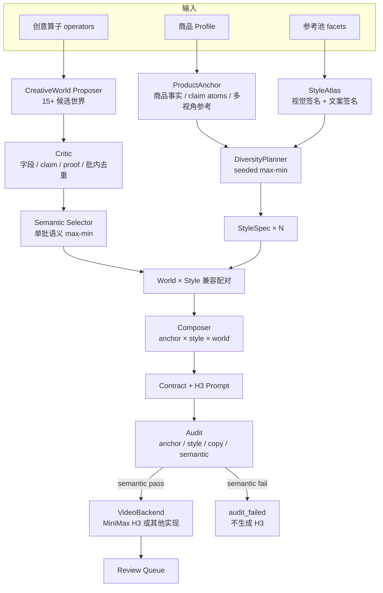

# Media Harness / AI 传媒工作台

一个面向短视频带货的 **product-anchored fission harness**：

> 给一个商品 Profile 和一批参考视频，系统从参考池学习镜头语法与风格，生成多个不同的创意世界，再编译成可审计的 contract / H3 prompt，最后可选地交给视频模型生成素材。

重点不是“写一条更好的 prompt”，而是把商品事实、风格采样、创意世界和视频生成拆成可组合、可审计、可移植的模块。

## 1. 架构总览



更紧凑的数据流：

```text
商品 Profile ──> ProductAnchor ─┐
参考池 facets ──> StyleAtlas ───┼─> Planner ─> StyleSpec
创意算子 ─────> CreativeWorld ──┴─> Semantic Selector ─> World
                                                        │
ProductAnchor + StyleSpec + World + Facet ─> Composer ─> Contract
                                                        │
                                                   H3 Prompt
                                                        │
                                                   Audit
                                                   ├─ pass → VideoBackend → Review
                                                   └─ fail → audit_failed
```

## 2. 裂变链路

### 2.1 阶段

| 阶段 | 做什么 | 主要模块 |
|---|---|---|
| `materials` | 增量准备参考描述、facets、beat↔镜头对齐 | `materials.py` |
| `anchor` | 从商品 Profile 构造不可变商品锚点 | `anchor.py` |
| `style_atlas` | 从 29 条参考 facet 抽视觉/文案签名 | `style_atlas.py` |
| `planner` | seeded max-min 采样风格，必要时补齐覆盖 | `planner.py` |
| `worlds` | LLM 生成 CreativeWorld，critic 校验，semantic selector 选 N 个 | `concept/` |
| `contracts` | anchor × style × world → contract / prompt / voiceover / SRT | `composer.py` |
| `audit` | anchor、style、copy、world/contract semantic 审计 | `audit.py` |
| `generation` | 可选调用 H3，逐条生成视频并进入审核队列 | `p0_runner.py` + `run_contract.py` |

### 2.2 三个正交层

**ProductAnchor：商品事实不可变**

- 商品 identity / category / must_show / must_not_change；
- 正面、背面、内里多视角参考图；
- `claim_atoms`：允许文案改写的事实原子；
- 禁用主张、人物授权、allowed person visibility。

风格、世界、文案都不能新增商品事实。

**StyleAtlas + Planner：风格是可采样空间**

- 从参考池抽取人物呈现、声音模式、机位、场景、节奏、字幕密度、文案 tone/hook/CTA；
- 视觉和文案分别做 seeded max-min，不把“某条手部视频恰好配某种文案”锁死；
- N≥5 时做覆盖合成（静物/字幕卡/voiceover 等），避免全部收敛成同一种口播。

**CreativeWorld：创意是完整小世界**

每个 world 不是卖点列表，而是：

```text
premise → tension → device → turn → payoff
```

商品只能通过 `proof_rituals` 进入：

```json
{
  "action": "手指捏住无痕包边轻拉再松手",
  "evidence": "无痕包边与三角版型",
  "claim_ids": ["feature_05"]
}
```

P0.2 还为每个 world 生成 LLM semantic 签名：

```json
{
  "social_frame": "合租女生",
  "core_device": "洗衣排班墙",
  "core_action": "按日期把三条内裤分袋",
  "proof_form": "排班表打勾 + 手洗对比",
  "visual_motif": "墙上的三色布袋",
  "turn_type": "从混洗吵架变成按日轮换"
}
```

字段名、权重、阈值和距离算法在 `concept/semantic.py` 固定；**具体值由 LLM 生成**，不维护固定世界枚举。Selector 只在本批内做 semantic max-min，不做跨 run 记忆。

### 2.3 契约与审计

`contract` 是链路的核心中间产物：

```text
target.format       12s / 9:16 / 768P / 人物呈现 / 声音 / 字幕
target.references   人物图 + 商品正面/背面/内里
target.product      商品身份 / must_show / must_not_change
structure.beats     时间轴 / 动作 / 商品证据 / claim_id / 信息层
structure.creative_world
facet_coverage
provenance
```

审计分四层：

- **anchor**：非法 claim_id、缺商品证据、缺商品参考图；
- **style**：视觉/文案距离、覆盖度；
- **copy**：hook/CTA 唯一性、跨变体重复句、重复短语；
- **semantic**：world `core_device` 唯一性、world 语义距离、contract 的 world/action/cast/claim 距离。

semantic 不通过时：

- 只出契约模式：状态 `audit_failed`，保留契约供检查；
- 生成模式：跳过 H3，不会继续消耗视频生成费用；
- resume 也会拒绝 semantic 未通过的 run。

## 3. 输入 / 输出

### 用户输入

| 输入 | 说明 |
|---|---|
| 商品 Profile | 商品事实、claims、must_show、不可改变项 |
| 商品图 | 默认取 Profile 正面图；可替换同款另一张照片 |
| 人物图 | 只复用人物身份；服装/场景由契约决定 |
| 数量 `n` | 本批契约/视频数量，默认 5 |
| seed | 风格采样种子；相同 seed 可复现同一批风格 |
| 素材解读 | 增量补齐 descriptions/facets/alignments |
| 强制重读素材 | 素材源变化时使用 |
| 只生成契约 | 不调用 H3，适合先检查 prompt/contract |
| 补充文字 | 后端可选字段；当前前端不暴露，避免软约束干扰 |

参考视频池是全局素材，用户不需要在单次裂变里手选对标。

### 输出

```text
data/runs/p0-<product>-<timestamp>-<id>/
  run.json
  anchor.json
  style_atlas.json
  style_plan.json
  worlds.json
  audit.json
  summary.json
  v01/
    contract.json
    prompt_h3.txt
    prompt_audit.md
    subtitles.srt
    voiceover.txt       # 有口播时
    variant_01.mp4      # generate=True 且 backend 成功
  v02/ ...
```

成功生成的视频同时进入 `outputs/review/` 审核队列。

## 4. 快速开始

```bash
# 1. Python 环境
python3.12 -m venv .venv
.venv/bin/pip install -r requirements.txt

# 2. 环境变量
cp .env.example .env
# 至少配置 LLM_API_KEY；需要 H3 时配置 MiniMax key

# 3. 启动后端
.venv/bin/uvicorn orchestrator.app.main:app --host 127.0.0.1 --port 8800

# 4. 构建前端
cd web && npm install && npm run build && cd ..

# 5. 打开
open http://127.0.0.1:8800/#/fission
```

### API：只生成契约

```bash
curl -s -X POST http://127.0.0.1:8800/api/jobs/fission-p0 \
  -H 'Content-Type: application/json' \
  -d '{
    "profile_id": "panty-cotton-lace",
    "n": 5,
    "seed": 20261022,
    "prepare_materials": true,
    "skip_generate": true
  }'
```

### API：生成视频

把 `skip_generate` 改为 `false`，系统会逐条调用 `scripts/run_contract.py`，把视频送入 `outputs/review/`。

### Harness：作为模块调用

```python
from pipelines.fission.harness import FissionHarness, HarnessRequest

harness = FissionHarness()
result = harness.run(HarnessRequest(
    profile_id="panty-cotton-lace",
    n=5,
    seed=20261022,
    generate=False,
))
print(result.status, result.run_dir)
print(result.audit["semantic"])
```

自定义视频 backend：

```python
class MyBackend:
    def generate(self, contract, prompt, out_dir, name, force=False):
        ...
        return {"provider_task": "...", "review_path": "..."}

harness = FissionHarness(video_backend=MyBackend())
```

完整端口和移植说明见 [docs/fission-harness.md](docs/fission-harness.md)。

## 5. 关键模块

```text
pipelines/fission/
  ports.py               LLM / facets / codec / material / profile / video / progress 协议
  context.py             HarnessContext，依赖容器
  anchor.py              ProductAnchor
  style_atlas.py         facet -> 视觉/文案风格
  planner.py             seeded max-min + coverage
  concept/               CreativeWorld、critic、semantic selector、审计
  composer.py            contract / H3 prompt 编译
  audit.py               anchor/style/copy/semantic
  materials.py           素材解读 adapter
  p0_runner.py           本地编排 + manifest/resume
  harness/               FissionHarness facade + local adapters
```

前端只暴露接口：

```text
POST /api/jobs/fission-p0
POST /api/fission/runs/{run_id}/resume
GET  /api/fission/runs
GET  /api/fission/runs/{run_id}
```

## 6. 测试

```bash
.venv/bin/python -m unittest discover -s tests -v
.venv/bin/python scripts/check_layout.py
cd web && npm run build
```

当前结果：

```text
27 tests OK
PASS=47 / WARN=1 / FAIL=0
```

契约测试 run（不生成视频）：

```text
data/runs/p0-harness-contract-v2/
status: contracts_done
contracts: 5
videos: 0
world semantic unique_core_devices: 5/5
world semantic min_distance: 1.0
contract semantic min_distance: 0.7704
```

## 7. 当前边界

- 这是 P0.2 的 backend harness，不是完全独立 SDK：`LocalMaterials` / `LocalCodec` / `RunContractBackend` 仍是当前项目适配器；
- 前端不提供 prompt/contract 编辑；需要手改时走 `skip_generate` + 文件修改；
- semantic selector 只保证单批语义分化，不保证最终视频视觉一定不同；仍需人工审核；
- 不做跨 run 记忆，历史 `data/worlds/registry.jsonl` 不参与生成；
- 生成后的暴露尺度、商品变形、道具跑偏必须人工审核。

## 8. 其他工作台能力

- 数字人口播：TTS + H3；
- 对标视频转换：换人/换脸/换场景；
- 带货视频 DirectorPlan：逐镜 H3；
- 节点画布：类型化节点图执行；
- 任务中心、素材库、审核队列、定时任务、成果墙。

这些能力的入口仍在 `/#/` 工作台和 `/#/canvas`。

## 9. 文档

- [裂变 P0.2 架构](docs/fission-p0-architecture.md)
- [裂变 harness 与移植边界](docs/fission-harness.md)
- [裂变重构记录](docs/fission-refactor.md)
- [UGC native 链路](docs/ugc-native-pipeline.md)
- [项目结构约束](docs/project-structure.md)
