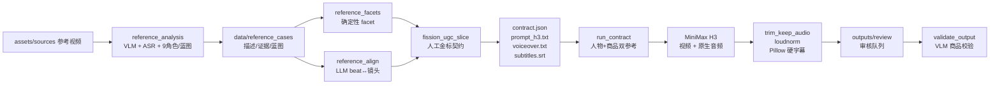

# UGC Native 链路解析

> 日期：2026-10-20
> 对象：`slice-1471-ugc-direction1` / `variant_ugc_native.mp4`
> 目标：把“参考池 → facet → 信息契约 → H3 原生音视频 → 审核”的模块、数据流、LLM 介入点和实际产物讲清楚。

## 0. 一句话

这条链路不是“让 LLM 写一段更热闹的提示词”，而是：

**用参考池的结构/信息做契约，用 H3 同一次生成完成画面 + 中文口播（BGM/音效由 prompt 引导，需听感验收），再用确定性后处理补字幕和审核。**

> v1.1 起口播只是“呈现车道”之一：同一批可以混排 `direct_speech`（正面口播）、`voiceover`（画外音）、`text_only`（无口播、纯字幕）、`ambient`（静物/ASMR、无台词），人物也可以 `full / partial / hands_only / none`。下文第 3 节的单条口播金标仍是其中一种车道的样例。

当前关键事实：
- LLM 参与“看懂参考、对齐结构、生成视频、校验商品”；
- **契约写作目前是人工金标**（`fission_ugc_slice.py`），不是 LLM 自由生成；
- H3 原生音轨已经包含同步中文口播，TTS 只作为后备。

> P0.2 已把这条链路产品化为 `POST /api/jobs/fission-p0`：
> 素材解读 → ProductAnchor → StyleAtlas → CreativeWorld → contract → H3 → 审核。
> 本文的单条人工金标仍是理解底层契约/生成的样例；P0.2 的编排、阶段和 resume 见
> [fission-p0-architecture.md](fission-p0-architecture.md)。

## 1. 总架构



标注：
- 🤖 = LLM/生成模型介入；
- ⚙️ = 确定性代码；
- ✍️ = 当前人工金标。

## 2. 模块职责表

| 阶段 | 模块/函数 | 输入 | 输出 | 性质 |
|---|---|---|---|---|
| 参考入库 | `reference_pool.py` | `assets/sources/*.mp4` + 人工确认 | `data/reference_pool.json` | ✍️/⚙️ |
| 参考描述 | `reference_analysis.analyze_one` | 参考视频 | `descriptions.json` / `evidence.json` / `prompt_blueprint.json` | 🤖 VLM + ASR |
| 视觉事实 | `reference_analysis.describe_visual:268` | 关键帧 + 转写 | `global` + `shots[]` | 🤖 DeepSeek Vision |
| 角色/蓝图 | `reference_analysis.roles_and_blueprint:350` | 视觉事实 + 转写 | 9 角色 + H3 blueprint | 🤖 DeepSeek Chat |
| ASR | `reference_analysis.transcribe:138` | 视频音轨 | 逐句转写 | 语音模型 |
| facet | `scripts/reference_facets.build_facets:141` | 描述/蓝图/证据 | `fission-facets/v0` | ⚙️ |
| beat 对齐 | `scripts/reference_align._call_llm:269` | facet + 镜头事实 | `llm_monotonic` 对齐 | 🤖 DeepSeek Chat |
| 契约 | `scripts/fission_ugc_slice.build_contract:81` | 1471/ bd6f/32b0 facet | `fission-contract/v1-ugc` | ✍️ 人工金标 |
| 契约校验 | `reference_contract.validate_contract:62` | contract + facet | errors/warnings | ⚙️ |
| Prompt 渲染 | `reference_contract.render_h3_prompt:232` | contract | `prompt_h3.txt` | ⚙️ |
| H3 生成 | `run_contract.main:152` + `minimax.video_generate_safe:381` | prompt + 人物图 + 商品图 | 视频 + 原生音频 | 🤖 MiniMax-H3 |
| 音频保留 | `media.trim_keep_audio:141` | raw H3 mp4 | 12s 带音轨视频 | ⚙️ |
| 响度 | `media.loudnorm:204` | 带音轨视频 | -16 LUFS | ⚙️ |
| 硬字幕 | `media.burn_subtitles_pil:209` | 视频 + SRT | 带字幕成片 | ⚙️ Pillow |
| 审核 | `store.add_review_item` | 成片 + 元数据 | `outputs/review/*` | ⚙️ |
| 商品校验 | `reference_fission.validate_output:528` | 成片帧 + 商品图 | identity/color/detail | 🤖 DeepSeek Vision |

## 3. LLM 介入点

### 3.1 参考描述：VLM + 角色/蓝图

- `describe_visual` 把关键帧和 ASR 一起交给 DeepSeek Vision，要求输出：
  - `global`：场景、风格、光线、色彩、节奏、机位、字幕风格、商品；
  - `shots[]`：景别/角度/机位/光线/构图/主体/动作/商品/可见度/画面文字/转场。
- `roles_and_blueprint` 用 DeepSeek Chat 输出 9 个角色视角（观众/编导/摄影/剪辑/美术/声音/营销/平台/生成工程）+ H3 蓝图。
- 实际例子（`bd6f`）：
  - 视觉事实：`shot 1` 百叶窗+桌面，双手持内裤；
  - 营销角色：`卖点顺序：卫生痛点→独立密封→EO灭菌→纯棉抗菌→弹力→耐洗`；
  - 蓝图：`hook=0-3秒质问式口播`。

这一步决定“参考池里到底有什么信息可复用”。旧链路的问题之一，是后面只用了画面字段，把营销角色/transcript 丢了。

### 3.2 beat ↔ 镜头对齐：LLM 做结构映射

- `reference_align._call_llm` 输入 beat 列表 + 逐镜事实，输出：
  ```json
  {"beat_index":1,"shot_indices":[1],"confidence":0.95,
   "evidence":"shot 1 画面文字...口播...直接对应痛点质问"}
  ```
- 约束：单调、允许一 beat 多镜/一镜多 beat、无法落地进 `unmatched_beats`。
- 实际例子（`bd6f`）：
  - beat 1 痛点质问 → shot 1，0.95；
  - beat 4 面料与弹力 → shot 6，0.9；
  - beat 6 多色收纳 → shot 8，0.85；
  - overall 0.82。
- 这一步让“契约里的 beat”能引用真实的参考镜头，而不是凭感觉写。

### 3.3 旧链路的 LLM：检索泛化 + 自由写方向（UGC native 不再走）

旧链路：
- `reference_retrieval.generalize:250`：把 top-k 文档交给 LLM 压成约束模板；
- `reference_fission.make_variant_briefs:137`：LLM 自由生成 5 个方向；
- `build_controlled_plan:363` / `_order_from_beat_order:263`：把方向压成固定 4 模块，hook 被推到第 3 镜。

问题：LLM 写方向时没有“信息槽位”和密度预算，结果自然滑向“品牌产品说明片”。

UGC native：
- **不再走 `generalize` / `make_variant_briefs`**；
- 直接读 facet，人工写一份金标契约，先验证 schema 和信息预算；
- 下一步才是让 LLM 在“信息契约 schema + 校验器”约束下写契约，而不是回到自由写方向。

### 3.4 契约写作：当前是人工金标，不是 LLM

`fission_ugc_slice.build_contract` 是确定性 Python，手写了 4 个 beat：
- beat 1 痛点钩子；
- beat 2 结构证明；
- beat 3 场景/多色；
- beat 4 价格/CTA。

每个 beat 都有：
`claim / proof / text_overlay / voiceover / persona / context / offer_cta`，
以及 `source{ref_id, beat_indices, shot_indices, fields_used, overrides}`。

这是**故意的人工金标**：
- 先证明 schema 能承载“真人 + 口播 + 字幕 + 卖点 + 证明 + 场景 + CTA”；
- 再把这个 schema 交给 LLM 批量填；
- 如果现在就 LLM 自由写，很容易又回到“形容词堆砌”的旧问题。

### 3.5 H3：同一次生成视频 + 原生音频

- `run_contract` 把 prompt + 参考图1（人物）+ 参考图2（商品）提交给 `MiniMax-H3`。
- H3 是 omni-modal 模型：视频和音频 latent 联合预测，原生输出对白、音效、环境音、BGM。
- 这一步是**像素和声音的生成**，不是文本 LLM。
- 实际输出 `variant_ugc_native.mp4`：
  - 12s / 768×1344 / 24fps；
  - 原生 AAC 音轨；
  - 切点 2.54 / 5.71 / 9.08s；
  - ASR 原生音轨（有同音字误差，按脚本校正；时间点来自 ASR）：
    小胸姐妹别划走 / 这件无钢圈内衣真能聚拢 / 宽肩带加高侧比 /
    背面四排扣稳稳托住 / 奶白蕾丝百搭 / 通勤居家都能穿 / 今天有活动价点下方看。
- 注意：这次 H3 生成的 prompt 里还写着“后期 TTS”，但 H3 仍根据每个 beat 的 `voiceover` 台词生成了原生对白；新 prompt 已改成显式“H3 原生同步音频”。

### 3.6 TTS：降为后备

- 旧管线 `trim_silent` 丢掉 H3 原生音轨，再用 TTS 重配；
- 新管线默认保留原生音轨；
- 只有 `--no-native-audio` 时才走 MiniMax TTS；MiniMax 余额不足时再降级 macOS `say`。
- 本次 `variant_ugc.mp4` 是 TTS 版（say），`variant_ugc_native.mp4` 是原生音频版；后者口型/台词更一致。

### 3.7 商品校验：VLM 只做硬约束

`reference_fission.validate_output` 用 DeepSeek Vision 看商品图 + 成片帧，输出：
`product_present / identity_match / color_match / detail_match / issues / verdict`。

本次原生版：
```json
{"product_present": true, "identity_match": 9, "color_match": 9,
 "detail_match": 9, "product_visibility": "full",
 "extra_garments": ["米色针织开衫","白色衬衫"],
 "on_screen_text": ["这件无钢圈内衣真能聚拢。","背面四排扣稳稳托住。","通勤居家都能穿。","点下方看。"],
 "verdict": "pass"}
```

注意：它只能证明“商品没变形变色”，不能证明“信息密度/口播/CTA 到位”；信息密度由契约校验负责。

## 4. 相比之前改了什么

| 维度 | 旧链路（product_demo） | UGC native |
|---|---|---|
| 范式 | 品牌产品说明片 | `ugc_individual_seller` |
| 参考使用 | BM25 top-12 + LLM 泛化 + 手写商品常量 | 直接读 facet：bd6f 结构/人物、32b0 卖点/多色、1471 商品 |
| 结构 | LLM 自由生成 5 方向 → 关键词折叠成 4 模块 | 人工金标 4 beat，1:1 进入 prompt |
| Hook | 常被推到第 3 镜（6–9s） | 第 1 beat 0–2.5s，动作 0–1s 开始 |
| 人物 | 无/仅手部 | 真人女主播 + 居家场景 |
| 信息 | 0 条主张、0 字幕、0 口播、0 CTA | 4 卖点 / 4 证明 / 4 字幕 / 4 口播 / 4 场景 / 1 CTA |
| 参考图 | 仅商品图 | 人物图 + 商品图（`target.references`） |
| 音频 | `trim_silent` 丢弃 H3 原生音轨 | 保留原生音轨 + loudnorm；TTS 后备 |
| 字幕 | 无 | Pillow 硬字幕（ffmpeg 无 libass） |
| 校验 | 只查 identity/color/detail | 契约校验（时间/来源/信息预算）+ 商品 VLM |
| 溯源 | 无 | 每 beat 的 `source` + `facet_coverage.used/adapted/waived` |
| 实际观感 | 纯白台面静物演示 | 真人居家口播种草 |

旧链路的关键函数仍在仓库里（`reference_fission.py`），但 UGC native 不走它们；它们保留给 product_demo 预设。

## 5. 实际案例：从三个 facet 到一条成片

### 5.1 选参考

- `ref-1792419234-1471`：商品来源；7 镜 / 42.5s；米白蕾丝无钢圈文胸；
- `ref-1792419234-bd6f`：个体带货结构；6 beat / 8 镜；真人居家口播、痛点质问、面料/弹力、多色收纳；
- `ref-1792419234-32b0`：文胸卖点/多色；3 镜 / 12.1s；真人上身、按压、五色平铺；7 个卖点、6 条文案。

### 5.2 契约（实际字段）

```json
{
  "schema_version": "fission-contract/v1-ugc",
  "target": {
    "references": [
      {"index": 1, "kind": "person", "path": "assets/persons/1792312878_1.png"},
      {"index": 2, "kind": "product", "path": "data/reference_runs/.../product.jpg"}
    ],
    "format": {
      "duration": 12, "aspect_ratio": "9:16", "resolution": "768P",
      "archetype": "ugc_individual_seller",
      "voiceover": true, "subtitles": true
    }
  },
  "structure": {
    "beats": [
      {
        "index": 1, "time": [0.0, 2.5], "function": "hook",
        "shot_size": "medium", "angle": "平视",
        "action": "真人面对镜头说话，右手把文胸举到胸前展示正面",
        "information": {
          "claim": "小胸也能穿出自然聚拢",
          "proof": "真人手持文胸正面展示 + 口播痛点",
          "text_overlay": "小胸姐妹别划走",
          "voiceover": "小胸姐妹别划走，这件无钢圈内衣真能聚拢。",
          "persona": "真人女主播，短发，米色针织开衫",
          "context": "居家客厅，自然窗光",
          "offer_cta": ""
        },
        "source": {
          "ref_id": "ref-1792419234-bd6f",
          "beat_indices": [1], "shot_indices": [1],
          "fields_used": ["shot_size","composition","action","on_screen_text"],
          "overrides": ["人物","口播","字幕","居家场景","价格CTA"]
        }
      }
    ]
  },
  "information_budget": {
    "claims": 4, "proofs": 2, "text_overlays": 4,
    "voiceovers": 4, "personas": 4, "contexts": 2, "offer_cta": 1
  }
}
```

### 5.3 Prompt（实际输出节选）

```text
【主体定义】
<Person 1> = 参考图1中的短发亚洲女性，脸型、发型、体型、肤色与参考图1一致。
参考图顺序：参考图1 = 固定人物照片1（只保留人物身份...）；参考图2 = 商品图1（只负责商品本身...）。

【全局合同】
范式：ugc_individual_seller。
场景：居家客厅/卧室：米色窗帘、浅木色柜、沙发一角，自然窗光...
机位：手机竖屏手持感：中景口播、近景产品特写、轻微推拉/晃动...
声音：H3 原生同步音频：真人女主播中文普通话口播...轻快流行 BGM...whoosh 轻音效...
文字：字幕后期叠加（白字黑边、大字号、居中偏下），不要生成在画面里...

【逻辑分镜时间轴】
[00:00.0-00:02.5 | beat 1 | 痛点钩子]
...
信息：卖点=小胸也能穿出自然聚拢；证明=真人手持文胸正面展示 + 口播痛点；
字幕（后期叠加，不要生成在画面里）=小胸姐妹别划走；
口播（与画面同步生成）=小胸姐妹别划走，这件无钢圈内衣真能聚拢。；
人物=真人女主播...；场景=居家客厅...
```

### 5.4 H3 实际输出

- 成片：`data/fission_slices/slice-1471-ugc-direction1/variant_ugc_native.mp4`
- 原始 H3：`outputs/tmp/fission_slice-20261020-104040-dbfed4_raw.mp4`（含 AAC 音轨）
- 切点：2.54 / 5.71 / 9.08s
- 商品校验：9 / 9 / 9，pass
- 原生音轨 ASR：与 4 条口播逐句一致（见 3.5）
- 审核：`outputs/review/variant_ugc_native.mp4`
- 抽帧：`data/fission_slices/slice-1471-ugc-direction1/contact_sheet.jpg`

### 5.5 与旧片对比

| 项 | 旧 `variant_contract` | 新 `variant_ugc_native` |
|---|---|---|
| 镜头/beat | 4 镜 | 4 beat |
| Hook | 第 3 镜 6–9s | 第 1 beat 0–2.5s |
| 人物 | 仅手部 | 真人女主播 |
| 场景 | 纯白台面 | 居家客厅/卧室/桌面 |
| 口播/字幕 | 无/无 | 原生口播/4 条硬字幕 |
| 明确卖点 | 0 条主张 | 4 条 |
| 参考来源 | 无 | 每 beat 有 source |
| 商品校验 | 9/9/9 | 9/9/9 |

## 6. 当前边界

1. **契约写作仍是人工金标**：下一步要让 LLM 在 `information` schema + 密度校验约束下填契约；不能回到自由写方向。
2. **H3 原生 BGM/音效需要听感验收**：口播已用 ASR 验证；BGM/音效是否合适要人工听。
3. **多色与严格单色冲突**：成片第 5 帧有黑/灰文胸；需要决定“同款多色”是否允许。
4. **试穿尺度**：第 4 帧白衬衫敞开 + 文胸；部分平台可能需要更保守的穿法。
5. **字幕仍靠后期**：H3 画面内文字不可靠；Pillow 硬字幕依赖本机字体。
6. **MiniMax TTS 余额不足**：原生音频路径不受影响；TTS 仅后备。
7. **32b0 只是 provenance 引用**：`fission_ugc_slice.py` 没有真正 programmatic 读取 32b0 facet 的卖点/字幕；当前是人工映射。批量时要改成读取。

## 7. 复现

```bash
# 1) 参考描述 / facet / 对齐（已有产物可跳过）
.venv/bin/python scripts/reference_describe.py
.venv/bin/python scripts/reference_facets.py
.venv/bin/python scripts/reference_align.py

# 2) 人工金标 UGC 契约 + prompt + 口播 + 字幕
.venv/bin/python scripts/fission_ugc_slice.py

# 3) H3 原生音视频 + 硬字幕 + 审核
.venv/bin/python scripts/run_contract.py \
  --contract data/fission_slices/slice-1471-ugc-direction1/contract.json \
  --prompt data/fission_slices/slice-1471-ugc-direction1/prompt_h3.txt \
  --out data/fission_slices/slice-1471-ugc-direction1 \
  --name variant_ugc_native.mp4

# 4) 商品校验 / 指标
.venv/bin/python - <<'PY'
from pathlib import Path
from orchestrator.app import reference_fission
print(reference_fission.validate_output(
  Path("data/fission_slices/slice-1471-ugc-direction1/variant_ugc_native.mp4"),
  Path("data/reference_runs/fission-20261019-235919/product.jpg"),
  Path("data/fission_slices/slice-1471-ugc-direction1"), 1))
PY
.venv/bin/python scripts/motion_metrics.py \
  --refs ref-1792419234-32b0 \
  --video data/fission_slices/slice-1471-ugc-direction1/variant_ugc_native.mp4
```
